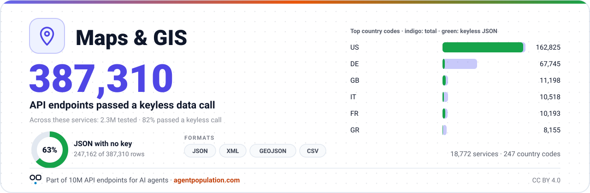
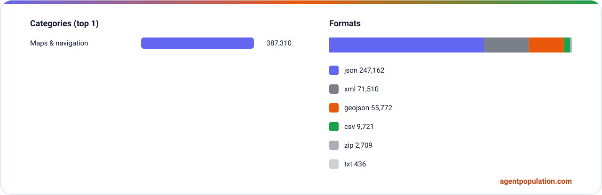

<p align="center"></p>

# 🗺️ Maps and GIS API endpoints

**387,310 map and GIS API endpoints that answered a keyless GET with a data body. For agent and app builders.**

<p align="center"><a href="#files"></a> <a href="#columns-and-tags"></a> <a href="#whats-inside"></a> <a href="#whats-inside"></a> <a href="LICENSE"></a></p>

<p align="center"><a href="#whats-in-it-for-you">What's in it</a> · <a href="#for-ai-agents">For AI agents</a> · <a href="#quick-start">Quick start</a> · <a href="#test-it-yourself">Test it yourself</a> · <a href="#files">Files</a> · <a href="#licence-and-credit">Licence</a> · <a href="#part-of-10m-api-endpoints-for-ai-agents">More packs</a></p>

This repository holds a 1,000-row sample and the services list; the full list of 387,310 endpoints is one download from the [latest release](https://github.com/agentpopulation/380k-maps-gis-apis-for-agents/releases/latest).

**Endpoints for building a map, place or boundary tool.** Map-layer queries (parcels, zoning, address points, contours), WMS and WFS map services, land-use and development plans, administrative boundaries by country, and place-name and postal-code files, as URLs that answered with no key on their test date.

Selection rule: rows where `category is "Navigation & Geo/Maps"`, less the rows that a leave-out rule drops (each counted under Known limits).

239,028 of these 387,310 rows match the focus rule (below); the others are in the pack by the selection rule only, and Known limits says what they are. 132,122 rows (34.1%) are map layers on ArcGIS Online, where anyone can publish.

## In plain words

**What is an API endpoint?** An API endpoint is one web address that a program can ask for data, for example the latest reading at one weather station. A single service, such as a national weather agency, can have thousands of endpoints: one per station, city or dataset. This pack counts endpoints, not separate services.

**What does "passed a data call" mean?** On the date shown in each row, AgentPopulation sent one plain request to that address, with no password or key, and got a non-empty data body back (JSON, CSV, XML or a file): not an error page and not an empty result. Some bodies describe a dataset rather than hold its values; see Known limits. It shows the address answered with data on that day. It is not a promise that it answers today, and licences and usage limits were not reviewed.

## What's in it for you

Four ways to use this pack. Each bucket gives a count, a filter you can apply to the CSV, one example that passed, and a list of recommended starting points with the rule that picked them. Buckets overlap; a row can fit more than one.

Examples, recommended lists and the preview are drawn from rows that match this pack's focus rule, so a row that the selection rule put in this pack but that is about something else is not shown as a starting point. Counts cover the whole bucket.

<details>
<summary>The focus rule</summary>

Focus rule: `(title or subcategory matches /boundar|border|address|parcel|cadast|zoning|land use|landuse|land cover|\bplan(s|o|ning)?\b|bebauungsplan|flächennutzungsplan|map|karte|carte|mappa|contour|elevation|terrain|topograph|orthophoto|aerial|district|municipal|\bwards?\b|census tract|county|region|postal|post code|zip code|place name|gazetteer|street|road|trail|\bparks?\b|building|footprint|geolog|soil|vegetation|wetland|watershed|coast|χάρτ|όρι|χρήσ|γης|οικοδομ|γεωτεμ|ρυμοτομ|mpzp|inspire|geoboundaries|geonames|OGC W[MF]S|ArcGIS feature layer|KML|GEOJSON|GML/i OR url matches /geoserver|[?&]service=w[mf]s|/wfs|/wms|/ows[/?]|/ogc/|featureserver|mapserver/i) AND NOT ((title matches /compan(y|ies)|employ|jobs|illness|enterprise statistics|corporate positions|contracts?\b|patent|deaths|unemploy|scholarship/i OR tags has statistics) AND NOT subcategory matches /OGC|ArcGIS|boundar|spatial|GML|KML|GEOJSON/i) AND NOT url matches ///(services[0-9]*(-[a-z0-9]+)?|utility)\.arcgis\.com//i`

</details>

### 🤖 Agent tools: Boundary, parcel, zoning and address layers an agent can query

**70,229** endpoints from 11,802 services · Wrap one layer query as a get_place_layer tool: pass a point, bounding box or country code, return the matching features (boundary name, parcel id, zoning class or address) with a timeout.

64,864 of these are map-layer queries that asked for a few records (`resultRecordCount`); add a geometry or a where clause to ask about one place, and page through for the whole layer.

Start with: `tags has agent-ready AND (host is www.geoboundaries.org OR title matches /boundar|address|parcel|cadast|zoning|zip code|postal|land use|landuse|district|\bwards?\b|municipal/i)`

Example: [International Territorial Level 3 (January 2021) …](https://open-geography-portalx-ons.hub.arcgis.com/api/download/v1/items/00a5aa3aa5a64183bd88c848ab9858d0/geojson?layers=0) · ArcGIS Online: Non · passed 2026-11-15

<details>
<summary>Recommended starting points: 8 services, picked by the stated criteria inside</summary>

**Recommended starting points.** Selected by stated criteria, not a ranking of quality: Services in this pack with the most endpoints that match this bucket and are tagged `agent-ready` (no key sent in the test call, JSON body, passed a data call). Ties go to the service with more country codes, then by name. Only services with at least one bucket row that matches the focus rule are listed, and the sample comes from those rows; the counts cover the whole bucket. The sample URL is the first row by URL sort after preferring, in this order: rows that match the bucket's sample preference when it has one, rows that return values rather than describe a dataset or a service (not ERDDAP /info/ pages, OGC GetCapabilities requests, bare OWS addresses, PxWeb tables, UN SDG series lists, Statistics Canada download pointers, WorldPop listings, GTFS validation reports, untitled rows or service root addresses), and agent-ready rows. Sample preference in this bucket: `NOT url matches ///(services[0-9]*(-[a-z0-9]+)?|utility)\.arcgis\.com//i AND NOT title matches /descontinuado|deprecated|discontinued/i`. Services named "ArcGIS organization" hold map layers from many owners and are added only when fewer than 5 other services match.

| Service (host) | Endpoints in bucket | In pack | Country codes in bucket | Formats in bucket | Sample URL that passed |
|---|---:|---:|---|---|---|
| ArcGIS Online: Non (open-geography-portalx-ons.hub.arcgis.com) | 1,243 | 3,449 | GB | json | [International Territorial Level 3 (Janu…](https://open-geography-portalx-ons.hub.arcgis.com/api/download/v1/items/00a5aa3aa5a64183bd88c848ab9858d0/geojson?layers=0) (2026-11-15) |
| Emsifa (www.emsifa.com) | 961 | 1,000 | ID | json | [emsifa API Wilayah Indonesia (BPS/Kemen…](https://www.emsifa.com/api-wilayah-indonesia/api/district/1101010.json) (2026-11-15) |
| Geoboundaries (www.geoboundaries.org) | 897 | 897 | 176 codes | json | [geoBoundaries gbAuthoritative ADM0 boun…](https://www.geoboundaries.org/api/current/gbAuthoritative/BDI/ADM0/) (2026-11-14) |
| Utahcounty (maps200.utahcounty.gov) | 402 | 858 | US | json | [maps200.utahcounty.gov: Assessor/Assr\_C…](https://maps200.utahcounty.gov/arcgis/rest/services/Assessor/Assr_Cities/MapServer/0/query?where=1%3D1&outFields=*&resultRecordCount=10&f=json) (2026-11-15) |
| Cityofirvine (gis.cityofirvine.org) | 396 | 440 | US | json | [gis.cityofirvine.org: ADT / City Bounda…](https://gis.cityofirvine.org/arcgis/rest/services/ADT/MapServer/0/query?where=1%3D1&outFields=*&resultRecordCount=10&f=json) (2026-11-15) |
| Yumacountyaz (arcgis.yumacountyaz.gov) | 358 | 413 | US | json | [arcgis.yumacountyaz.gov: 2023\_Tax\_Deed\_…](https://arcgis.yumacountyaz.gov/webgis/rest/services/2023_Tax_Deed_Parcels/MapServer/2/query?where=1%3D1&outFields=*&resultRecordCount=10&f=json) (2026-11-15) |
| Esri (ArcGIS Online) (p3eplmys2rvchkjx.svcs.arcgis.com) | 320 | 650 | US | json | [p3eplmys2rvchkjx.svcs.arcgis.com: ACS\_1…](https://p3eplmys2rvchkjx.svcs.arcgis.com/P3ePLMYs2RVChkJx/arcgis/rest/services/ACS_10_14_Children_in_Grandparent_Households_Boundaries/FeatureServer/0/query?where=1%3D1&outFields=*&resultRecordCount=10&f=json) (2026-11-15) |
| ArcGIS Online publisher (lkfyxb9zdq7vaoam.svcsdev.arcgis.com) | 276 | 3,629 | US | json | [lkfyxb9zdq7vaoam.svcsdev.arcgis.com: 3D…](https://lkfyxb9zdq7vaoam.svcsdev.arcgis.com/LkFyxb9zDq7vAOAm/arcgis/rest/services/3DSymbols2DLayers_WFL1/FeatureServer/2/query?where=1%3D1&outFields=*&resultRecordCount=10&f=json) (2026-11-15) |

</details>

### 📱 App features: Map services and vector files to draw: WMS, WFS, GeoJSON and KML

**98,806** endpoints from 911 services · Add base maps, orthophotos and vector layers to an app map: read the service layer list once, then request the map or features for the visible area.

35,373 of these are GetCapabilities requests: they list the layers of a WMS or WFS service; ask GetMap or GetFeature for the map or the features.

Start with: `format is geojson OR subcategory matches /OGC W[MF]S|KML|GEOJSON|GML/i`

Example: [Gemeinde Großbettlingen (geodienste.komm.one): WF…](https://geodienste.komm.one/ows/services/org.104.09cb9500-5f52-4d4f-a58e-10b0efe1cfc6_wfs/org.104.21879498-2b4a-43cc-a6e8-b5bcc930c558?SERVICE=WFS&REQUEST=GetFeature&VERSION=2.0.0&TYPENAMES=plu:OfficialDocumentation&COUNT=10&OUTPUTFORMAT=application%2Fgeo%2Bjson) · Komm · passed 2026-11-15

<details>
<summary>Recommended starting points: 8 services, picked by the stated criteria inside</summary>

**Recommended starting points.** Selected by stated criteria, not a ranking of quality: Services in this pack with the most endpoints that match this bucket and passed a data call. Ties go to the service with more country codes, then by name. Only services with at least one bucket row that matches the focus rule are listed, and the sample comes from those rows; the counts cover the whole bucket. The sample URL is the first row by URL sort after preferring, in this order: rows that match the bucket's sample preference when it has one, rows that return values rather than describe a dataset or a service (not ERDDAP /info/ pages, OGC GetCapabilities requests, bare OWS addresses, PxWeb tables, UN SDG series lists, Statistics Canada download pointers, WorldPop listings, GTFS validation reports, untitled rows or service root addresses), and agent-ready rows. Sample preference in this bucket: `NOT url matches /[?&]request=getcapabilities/i`. Services named "ArcGIS organization" hold map layers from many owners and are added only when fewer than 5 other services match.

| Service (host) | Endpoints in bucket | In pack | Country codes in bucket | Formats in bucket | Sample URL that passed |
|---|---:|---:|---|---|---|
| Komm (geodienste.komm.one) | 21,890 | 21,892 | DE | xml, geojson | [Gemeinde Großbettlingen (geodienste.kom…](https://geodienste.komm.one/ows/services/org.104.09cb9500-5f52-4d4f-a58e-10b0efe1cfc6_wfs/org.104.21879498-2b4a-43cc-a6e8-b5bcc930c558?SERVICE=WFS&REQUEST=GetFeature&VERSION=2.0.0&TYPENAMES=plu:OfficialDocumentation&COUNT=10&OUTPUTFORMAT=application%2Fgeo%2Bjson) (2026-11-15) |
| daten.bw - Das Datenportal für Baden-Wür (haleconnect.com) | 6,094 | 6,192 | AT, DE, DK | xml, geojson | [Waldburg (haleconnect.com): WFS 2.0.0](https://haleconnect.com/ows/services/org.1001.0f067959-b465-4a54-9a13-d2502d76b156_wfs/org.1001.0f914212-ed22-4e4f-aeb2-76d0e507cbe4?SERVICE=WFS&REQUEST=GetFeature&VERSION=2.0.0&TYPENAMES=plu:OfficialDocumentation&COUNT=10&OUTPUTFORMAT=application%2Fgeo%2Bjson) (2026-11-15) |
| Govconnect (inspire.govconnect.de) | 3,398 | 3,440 | DE | xml, geojson | [Gemeinde Hatten (inspire.govconnect.de)…](https://inspire.govconnect.de/ows/services/org.100.1cba2b5c-8d62-49c1-9d64-9974a7bfb45b_wfs/org.100.851d65f6-81c2-44e8-ac3a-f0886dc64e6e?SERVICE=WFS&REQUEST=GetFeature&VERSION=2.0.0&TYPENAMES=ogr:kdo_planung&COUNT=10&OUTPUTFORMAT=application%2Fgeo%2Bjson) (2026-11-15) |
| DOV Flanders subsoil / water (www.dov.vlaanderen.be) | 2,437 | 2,494 | BE | xml, geojson | [INSPIRE harmonized - Erosion sensitivit…](https://www.dov.vlaanderen.be/geoserver-inspire/exposedelement/wfs?SERVICE=WFS&version=2.0.0&request=GetFeature&count=1&typeName=ExposedElement) (2026-11-14) |
| Stadt Zürich Open Data (www.ogd.stadt-zuerich.ch) | 1,149 | 1,167 | CH | geojson, xml | [www.ogd.stadt-zuerich.ch: WFS 1.1.0](https://www.ogd.stadt-zuerich.ch/wfs/geoportal/3D_Dachmodell_LoD2_Jahresstand_2011?SERVICE=WFS&REQUEST=GetFeature&VERSION=1.1.0&TYPENAME=lod2_geb3d&MAXFEATURES=10&OUTPUTFORMAT=application%2Fvnd.geo%2Bjson) (2026-11-15) |
| Berlin Government Open Data Portal (gdi.berlin.de) | 1,023 | 1,197 | DE | geojson, xml | [Senatsverwaltung für Stadtentwicklung, …](https://gdi.berlin.de/services/wfs/abstell_mikromob?SERVICE=WFS&REQUEST=GetFeature&VERSION=2.0.0&TYPENAMES=abstell_mikromob:abstell_mikromob&COUNT=10&OUTPUTFORMAT=application%2Fjson) (2026-11-15) |
| Liguria (geoservizi.regione.liguria.it) | 1,011 | 1,074 | IT | geojson, xml | [The ancient geographes INC (geoservizi.…](https://geoservizi.regione.liguria.it/geoserver/ows?SERVICE=WFS&REQUEST=GetFeature&VERSION=2.0.0&TYPENAMES=M1015:L2451&COUNT=10&OUTPUTFORMAT=application%2Fjson) (2026-11-15) |
| Lounaistieto (geoserver.lounaistieto.fi) | 961 | 1,011 | FI | geojson, xml | [Varsinais-Suomen liitto (geoserver.loun…](https://geoserver.lounaistieto.fi/geoserver/ows?SERVICE=WFS&REQUEST=GetFeature&VERSION=2.0.0&TYPENAMES=HAME:HAME_vsl_aluevaraukset&COUNT=10&OUTPUTFORMAT=application%2Fjson) (2026-11-15) |

</details>

### 🧠 Grounding and data pipelines: Boundaries, place names, postal codes and land-use tables for scheduled loads

**69,099** endpoints from 1,129 services · Load place names, postal codes, boundaries and land-use layers on a schedule into your own store, so an agent can turn a place name into coordinates and a region and cite a dated source.

Start with: `host in (download.geonames.org, www.geoboundaries.org) OR format in (csv, zip, geojson)`

Example: [International Territorial Level 3 (January 2021) …](https://open-geography-portalx-ons.hub.arcgis.com/api/download/v1/items/00a5aa3aa5a64183bd88c848ab9858d0/csv?layers=0) · ArcGIS Online: Non · passed 2026-11-15

<details>
<summary>Recommended starting points: 8 services, picked by the stated criteria inside</summary>

**Recommended starting points.** Selected by stated criteria, not a ranking of quality: Services in this pack with the most endpoints that match this bucket and passed a data call. Ties go to the service with more country codes, then by name. Only services with at least one bucket row that matches the focus rule are listed, and the sample comes from those rows; the counts cover the whole bucket. The sample URL is the first row by URL sort after preferring, in this order: rows that match the bucket's sample preference when it has one, rows that return values rather than describe a dataset or a service (not ERDDAP /info/ pages, OGC GetCapabilities requests, bare OWS addresses, PxWeb tables, UN SDG series lists, Statistics Canada download pointers, WorldPop listings, GTFS validation reports, untitled rows or service root addresses), and agent-ready rows. Sample preference in this bucket: `host in (download.geonames.org, www.geoboundaries.org) OR title matches /boundar|όρι|address|parcel|cadast|land use|χρήσεις γης|γεωτεμ|περιφέρει/i`. Services named "ArcGIS organization" hold map layers from many owners and are added only when fewer than 5 other services match.

| Service (host) | Endpoints in bucket | In pack | Country codes in bucket | Formats in bucket | Sample URL that passed |
|---|---:|---:|---|---|---|
| ArcGIS Online: Non (open-geography-portalx-ons.hub.arcgis.com) | 2,102 | 3,449 | GB | csv, zip, geojson | [International Territorial Level 3 (Janu…](https://open-geography-portalx-ons.hub.arcgis.com/api/download/v1/items/00a5aa3aa5a64183bd88c848ab9858d0/csv?layers=0) (2026-11-15) |
| Nyu (maps-public.geo.nyu.edu) | 940 | 996 | US | geojson | [maps-public.geo.nyu.edu: WFS 2.0.0](https://maps-public.geo.nyu.edu/geoserver/ows?SERVICE=WFS&REQUEST=GetFeature&VERSION=2.0.0&TYPENAMES=sdr:nyu_2451_33987&COUNT=10&OUTPUTFORMAT=application%2Fjson) (2026-11-15) |
| DOV Flanders subsoil / water (www.dov.vlaanderen.be) | 937 | 2,494 | BE | geojson | [www.dov.vlaanderen.be: OGC API Features](https://www.dov.vlaanderen.be/geoserver/ogc/features/v1/collections/delfstoffen:boringen_zand_grind/items?f=application%2Fjson&limit=10) (2026-11-15) |
| Lounaistieto (geoserver.lounaistieto.fi) | 936 | 1,011 | FI | geojson | [Varsinais-Suomen liitto (geoserver.loun…](https://geoserver.lounaistieto.fi/geoserver/ows?SERVICE=WFS&REQUEST=GetFeature&VERSION=2.0.0&TYPENAMES=HAME:HAME_vsl_aluevaraukset&COUNT=10&OUTPUTFORMAT=application%2Fjson) (2026-11-15) |
| Govconnect (inspire.govconnect.de) | 929 | 3,440 | DE | geojson | [Gemeinde Hatten (inspire.govconnect.de)…](https://inspire.govconnect.de/ows/services/org.100.1cba2b5c-8d62-49c1-9d64-9974a7bfb45b_wfs/org.100.851d65f6-81c2-44e8-ac3a-f0886dc64e6e?SERVICE=WFS&REQUEST=GetFeature&VERSION=2.0.0&TYPENAMES=ogr:kdo_planung&COUNT=10&OUTPUTFORMAT=application%2Fgeo%2Bjson) (2026-11-15) |
| Berlin Government Open Data Portal (gdi.berlin.de) | 925 | 1,197 | DE | geojson | [Senatsverwaltung für Stadtentwicklung, …](https://gdi.berlin.de/services/wfs/abstell_mikromob?SERVICE=WFS&REQUEST=GetFeature&VERSION=2.0.0&TYPENAMES=abstell_mikromob:abstell_mikromob&COUNT=10&OUTPUTFORMAT=application%2Fjson) (2026-11-15) |
| Csiro (www.cmar.csiro.au) | 908 | 979 | AU | geojson | [CSIRO National Collections & Marine Inf…](https://www.cmar.csiro.au/geoserver/ows?SERVICE=WFS&REQUEST=GetFeature&VERSION=2.0.0&TYPENAMES=AusSeabed:BF2018_V01_Hope_Channel_1m_final_BBOX&COUNT=10&OUTPUTFORMAT=application%2Fjson) (2026-11-15) |
| Komm (geodienste.komm.one) | 905 | 21,892 | DE | geojson | [Gemeinde Großbettlingen (geodienste.kom…](https://geodienste.komm.one/ows/services/org.104.09cb9500-5f52-4d4f-a58e-10b0efe1cfc6_wfs/org.104.21879498-2b4a-43cc-a6e8-b5bcc930c558?SERVICE=WFS&REQUEST=GetFeature&VERSION=2.0.0&TYPENAMES=plu:OfficialDocumentation&COUNT=10&OUTPUTFORMAT=application%2Fgeo%2Bjson) (2026-11-15) |

</details>

### 🧪 Evals and testing: Layer queries, map services and files to test a map tool

**387,310** endpoints · 18,772 services · 247 country codes · 6 formats · Run your map tool against a fixed set of URLs across formats; check that features, coordinates and layer lists parse, and keep last_tested as the baseline for your own re-tests.

Start with: the whole pack

Example: [Stadt Aalen (geodienste.komm.one): WFS 2.0.0](https://geodienste.komm.one/ows/services/org.107.7e499bca-5e63-4595-b3c4-eaece8b68608_wfs/org.107.c586e936-b3ac-4b4a-bd66-26e147878ce1?SERVICE=WFS&REQUEST=GetFeature&VERSION=2.0.0&TYPENAMES=xplan:BP_Plan&COUNT=10&OUTPUTFORMAT=application%2Fgeo%2Bjson) · Komm · passed 2026-11-15

<details>
<summary>Recommended starting points: 8 services, picked by the stated criteria inside</summary>

**Recommended starting points.** Selected by stated criteria, not a ranking of quality: Services in this pack that returned the most different formats, then the most endpoints that passed a data call, then by name: a mix of response shapes to test parsers and tool calls. Only services with at least one bucket row that matches the focus rule are listed, and the sample comes from those rows; the counts cover the whole bucket. The sample URL is the first row by URL sort after preferring, in this order: rows that match the bucket's sample preference when it has one, rows that return values rather than describe a dataset or a service (not ERDDAP /info/ pages, OGC GetCapabilities requests, bare OWS addresses, PxWeb tables, UN SDG series lists, Statistics Canada download pointers, WorldPop listings, GTFS validation reports, untitled rows or service root addresses), and agent-ready rows. Services named "ArcGIS organization" hold map layers from many owners and are added only when fewer than 5 other services match.

| Service (host) | Endpoints in bucket | In pack | Country codes in bucket | Formats in bucket | Sample URL that passed |
|---|---:|---:|---|---|---|
| ArcGIS Online: Non (open-geography-portalx-ons.hub.arcgis.com) | 3,449 | 3,449 | GB | json, csv, zip, geojson, xml | [International Territorial Level 3 (Janu…](https://open-geography-portalx-ons.hub.arcgis.com/api/download/v1/items/00a5aa3aa5a64183bd88c848ab9858d0/geojson?layers=0) (2026-11-15) |
| geodienste.hamburg.de | 1,269 | 1,269 | DE | xml, geojson, json, zip, csv | [LGV Hamburg (geodienste.hamburg.de): WF…](https://geodienste.hamburg.de/HH_WFS_Abwasserentsorgungsgebiet_Hamburg_Wasser?SERVICE=WFS&REQUEST=GetFeature&VERSION=2.0.0&TYPENAMES=app:abwasserentsorgungsgebiet&COUNT=10&OUTPUTFORMAT=application%2Fgeo%2Bjson) (2026-11-15) |
| Freiburg (geoportal.freiburg.de) | 364 | 364 | DE | geojson, xml, zip, json, csv | [Baublöcke der Stadt Freiburg i. Br.](https://geoportal.freiburg.de/wfs/abi_gliederung/abi_gliederung?REQUEST=GetFeature&SRSNAME=EPSG:25832&SERVICE=WFS&VERSION=2.0.0&TYPENAMES=baubloecke&OUTPUTFORMAT=geojson) (2026-11-14) |
| geo.sv.rostock.de | 357 | 357 | DE | xml, csv, geojson, json, txt | [addresses](https://geo.sv.rostock.de/download/opendata/adressen/adressen.json) (2026-11-14) |
| data.gov.au (datahub.moretonbay.qld.gov.au) | 252 | 252 | AU | json, csv, xml, geojson, zip | [Overlay Maps:OC08 Koala Conservation - …](https://datahub.moretonbay.qld.gov.au/api/download/v1/items/2fa171d648414bc3834c74f0def35069/csv?layers=10) (2026-11-15) |
| Wien (data.wien.gv.at) | 154 | 154 | AT | csv, xml, json, geojson, zip | [data.wien.gv.at: Area types 2021 Vienna…](https://data.wien.gv.at/daten/geo?service=WFS&request=GetFeature&version=1.1.0&srsName=EPSG:4326&outputFormat=json&typeName=ogdwien:GEBIETSTYPENOGD) (2026-11-15) |
| Data Driven Detroit (portal.datadrivendetroit.org) | 136 | 136 | US | csv, xml, json, geojson, zip | [OC Parcel History - GeoJSON](https://portal.datadrivendetroit.org/api/download/v1/items/00343406b1164a4690f23c307c25d679/geojson?layers=3) (2026-11-15) |
| data.gis.ny.gov | 124 | 124 | US | json, csv, zip, xml, geojson | [State - GeoJSON](https://data.gis.ny.gov/api/download/v1/items/074d3456e5664f5e85d0fb251d05cc5b/geojson?layers=0) (2026-11-15) |

</details>

The same lists are in [recommended.json](recommended.json), ready for an agent to load.

## Questions an agent can answer with this pack

- Where is the GeoJSON of the first-level administrative regions of a country? Try [geoBoundaries gbOpen ADM1 boundaries: Afghanistan](https://www.geoboundaries.org/api/current/gbOpen/AFG/ADM1/) (Geoboundaries, passed 2026-11-14).
- Which address points does the Maryland addressing layer return for a city? Try [Allegany County Address Points](https://mdgeodata.md.gov/appdata/rest/services/Addressing/MD_Addressing/MapServer/0/query?where=1%3D1&outFields=*&returnGeometry=false&resultRecordCount=5&f=json) (mdgeodata.md.gov, passed 2026-11-15).
- Which layers does the map service of a German municipal development plan offer? Try [Development plans of the municipality of Durlange…](https://haleconnect.com/ows/services/org.1038.b121bbce-3153-4eca-aac1-dc1e8153430e_wfs?SERVICE=WFS&Request=GetCapabilities) (daten.bw - Das Datenportal für Baden-Wür, passed 2026-11-14).

## What "passed a data call" means

> [!NOTE]
> On the date in `last_tested` (IST), one GET to the URL, sent with no key, returned HTTP 2xx and a non-empty data body. HTML pages and empty results did not pass. The `format` column records what came back. This is a test result for that date, not a promise that the URL answers today. Licences, terms, rate limits, accuracy and freshness were not reviewed. Endpoints are URLs, not separate APIs; many share one service. This pack was tested 10–15 Nov 2026; snapshot 15 Nov 2026.

## For AI agents

Start from keyless JSON endpoints (`agent-ready`). The code below loads `recommended.json` and calls the first recommended service in the Agent tools bucket, with a timeout (`node examples/agent-start.mjs --recommended`). With no argument, `node examples/agent-start.mjs` calls the most recently tested agent-ready row of the sample; pass a `.csv` or `.csv.gz` path to use that file instead. See [examples/agent-start.mjs](examples/agent-start.mjs).

```js
// Node 18+. Loads recommended.json (the local copy, or the raw file on GitHub) and calls one keyless JSON endpoint.
import fs from 'node:fs';

const RAW = 'https://raw.githubusercontent.com/agentpopulation/380k-maps-gis-apis-for-agents/main/recommended.json';
const rec = fs.existsSync('recommended.json')
  ? JSON.parse(fs.readFileSync('recommended.json', 'utf8'))
  : await (await fetch(RAW)).json();

const pick = rec.buckets.find((b) => b.id === 'agent').services[0];
try {
  const res = await fetch(pick.sample_url, {
    headers: { 'User-Agent': 'agent-example/1.0' },
    signal: AbortSignal.timeout(15000),
  });
  console.log(pick.service, res.status, res.headers.get('content-type'));
  console.log((await res.text()).slice(0, 300));
} catch (err) {
  console.log(`did not answer now; last passed ${pick.sample_last_tested} (${err.message})`);
}
```

How an agent picks an endpoint:

1. Filter to `agent-ready` and your country or topic.
2. Prefer the newest `last_tested` and the larger services.
3. Call with a timeout and check the body before you use it.

## Quick start

The examples run against the sample in `data/` out of the box (1,000 rows). Each takes an optional path to a `.csv` or `.csv.gz` file instead.

```bash
git clone https://github.com/agentpopulation/380k-maps-gis-apis-for-agents.git
cd 380k-maps-gis-apis-for-agents
python examples/quickstart.py
node examples/quickstart.mjs
node examples/agent-start.mjs
```

Full list: download `Maps_GIS_API_Endpoints_AgentPopulation_Snapshot_2026-11-15.csv.gz` (387,310 rows, 14.9 MB) from [releases/latest](https://github.com/agentpopulation/380k-maps-gis-apis-for-agents/releases/latest), then gunzip it and pass its path. The scripts also read the `.csv.gz` as it is.

```bash
gunzip Maps_GIS_API_Endpoints_AgentPopulation_Snapshot_2026-11-15.csv.gz
python examples/quickstart.py Maps_GIS_API_Endpoints_AgentPopulation_Snapshot_2026-11-15.csv
node examples/quickstart.mjs Maps_GIS_API_Endpoints_AgentPopulation_Snapshot_2026-11-15.csv
```

### curl

Quote the URL: some contain commas.

```bash
curl -sL "https://raw.githubusercontent.com/agentpopulation/380k-maps-gis-apis-for-agents/main/data/Maps_GIS_API_Endpoints_AgentPopulation_Sample.csv" | head -n 4
curl -s --max-time 15 "https://open-geography-portalx-ons.hub.arcgis.com/api/download/v1/items/00a5aa3aa5a64183bd88c848ab9858d0/geojson?layers=0" | head -c 600
```

### Python

Standard library only: [examples/quickstart.py](examples/quickstart.py) reads the sample, or the path you pass, keeps agent-ready rows and calls the most recently tested one.

<details>
<summary>The code</summary>

```python
# Python 3, standard library only. Run from a clone of this repository:
#   python examples/quickstart.py [path]
# With no path it reads the sample in data/. Pass the full list from the latest release (.csv or .csv.gz) instead.
# Keeps agent-ready rows and calls the most recently tested one.
import csv
import gzip
import os
import re
import sys
import urllib.request

HERE = os.path.dirname(os.path.abspath(__file__))
path = sys.argv[1] if len(sys.argv) > 1 else os.path.join(HERE, "..", "data", "Maps_GIS_API_Endpoints_AgentPopulation_Sample.csv")
opener = gzip.open if path.endswith(".gz") else open
with opener(path, "rt", newline="", encoding="utf-8") as f:
    rows = list(csv.DictReader(f))

agent = [r for r in rows if "agent-ready" in r["tags"].split("|")]
# Newest test date first; URLs that describe a dataset or a service rather than return values go last.
DESCRIBES = re.compile(r"/erddap/info/|action-report\.json$|[?&]request=getcapabilities|/GeoArea/[^/?]+/List|getFullTableDownloadCSV|hub\.worldpop\.org", re.I)
agent.sort(key=lambda r: r["last_tested"], reverse=True)
agent.sort(key=lambda r: 1 if DESCRIBES.search(r["url"]) else 0)
print(len(rows), "rows,", len(agent), "agent-ready")
if not agent:
    sys.exit(0)

row = agent[0]
req = urllib.request.Request(row["url"], headers={"User-Agent": "agent-example/1.0"})
try:
    with urllib.request.urlopen(req, timeout=15) as res:
        body = res.read(1_000_000).decode("utf-8", "replace")
        print(res.status, res.headers.get("Content-Type"))
        print(body[:300])
except Exception as err:
    print(f"did not answer now; last passed {row['last_tested']} ({err})")
```

</details>

### JavaScript

Reads the sample as JSON because the CSV has quoted commas.

<details>
<summary>The code</summary>

```js
// Node 18+. Reads the sample as JSON (the CSV has quoted commas), local file first.
import fs from 'node:fs';

const FILE = 'data/Maps_GIS_API_Endpoints_AgentPopulation_Sample.json';
const rows = fs.existsSync(FILE)
  ? JSON.parse(fs.readFileSync(FILE, 'utf8'))
  : await (await fetch('https://raw.githubusercontent.com/agentpopulation/380k-maps-gis-apis-for-agents/main/data/Maps_GIS_API_Endpoints_AgentPopulation_Sample.json')).json();

const row = rows.find((r) => r.tags.includes('agent-ready'));
const res = await fetch(row.url, { headers: { 'User-Agent': 'agent-example/1.0' }, signal: AbortSignal.timeout(15000) });
console.log(res.status, (await res.text()).slice(0, 300));
```

</details>

### Agent tools

[examples/agent-tools.json](examples/agent-tools.json) holds two tool definitions in the shape most tool-calling APIs accept (name, description, JSON Schema); rename `parameters` if yours uses another key. [examples/quickstart.mjs](examples/quickstart.mjs) implements them:

- `find_endpoints` searches the agent-ready rows of the list by words, country code (their format is json). When you load the tools of more than one pack, prefix the names (for example `maps_gis_find_endpoints`) so they do not clash.
- `fetch_endpoint` calls one URL, **refuses any URL that is not in the list** and does not follow redirects. The allowlist is built from the CSV, so a URL injected into a prompt is refused.

The same two tools can sit behind an MCP server.

## Test it yourself

Re-test endpoints from the sample with the same rule: HTTP 2xx and a non-empty body that is not an HTML page. Node 18+, no packages.

```bash
node tools/test-endpoints.mjs
```

It tests the first 50 URLs and prints one line: tested, passed, did not pass. Options: a `.csv` or `.csv.gz` path (the full list from the release), `--limit 50`, `--timeout-ms 10000`, `--out results.csv`. The results file holds `url`, `status`, `passed`, `content_type`, `ms` and `checked_at`; a status of `timeout` or `error:<code>` means no HTTP answer came back. It is polite: GET only, no key sent, at most 4 requests in flight, one at a time per listed host, at least 1 second between requests to one listed host, and reading stops once 256 kB of a body is kept. Redirects are followed and may lead to another host. `results.csv` is in `.gitignore`.

## Preview

One row from each of the five largest services among rows that match the focus rule, services with rows that return values first.

| Title | Service | Country | Format | Tested | Link |
|---|---|---|---|---|---|
| Stadt Aalen (geodienste.komm.one): WFS 2.0.0 | Komm | DE | json | 2026-11-15 | [geodienste.komm.one](https://geodienste.komm.one/ows/services/org.107.7e499bca-5e63-4595-b3c4-eaece8b68608_wfs/org.107.c586e936-b3ac-4b4a-bd66-26e147878ce1?SERVICE=WFS&REQUEST=GetFeature&VERSION=2.0.0&TYPENAMES=xplan:BP_Plan&COUNT=10&OUTPUTFORMAT=application%2Fgeo%2Bjson) |
| Waldburg (haleconnect.com): WFS 2.0.0 | daten.bw - Das Datenportal für Baden-Wür | global or unknown | geojson | 2026-11-15 | [haleconnect.com](https://haleconnect.com/ows/services/org.1001.0f067959-b465-4a54-9a13-d2502d76b156_wfs/org.1001.0f914212-ed22-4e4f-aeb2-76d0e507cbe4?SERVICE=WFS&REQUEST=GetFeature&VERSION=2.0.0&TYPENAMES=plu:OfficialDocumentation&COUNT=10&OUTPUTFORMAT=application%2Fgeo%2Bjson) |
| lkfyxb9zdq7vaoam.svcsdev.arcgis.com: \[Public\]\_Layer / Layer… | ArcGIS Online publisher | US | json | 2026-11-15 | [lkfyxb9zdq7vaoam.svcsdev.arcgis.com](https://lkfyxb9zdq7vaoam.svcsdev.arcgis.com/LkFyxb9zDq7vAOAm/arcgis/rest/services/%5BPublic%5D_Layer/FeatureServer/0/query?where=1%3D1&outFields=*&resultRecordCount=10&f=json) |
| Stadt Pattensen (inspire.govconnect.de): WFS 2.0.0 | Govconnect | DE | json | 2026-11-15 | [inspire.govconnect.de](https://inspire.govconnect.de/ows/services/org.111.278a1d91-2026-46f7-a5ac-021411f10f1d_wfs?SERVICE=WFS&REQUEST=GetFeature&VERSION=2.0.0&TYPENAMES=xplan:FP_Bereich&COUNT=10&OUTPUTFORMAT=application%2Fgeo%2Bjson) |
| International Territorial Level 3 (January 2021) Boundaries… | ArcGIS Online: Non | GB | json | 2026-11-15 | [open-geography-portalx-ons.hub.arcgis.com](https://open-geography-portalx-ons.hub.arcgis.com/api/download/v1/items/00a5aa3aa5a64183bd88c848ab9858d0/geojson?layers=0) |

Browse the 1,000-row sample: [Sample CSV](data/Maps_GIS_API_Endpoints_AgentPopulation_Sample.csv) · [Sample JSON](data/Maps_GIS_API_Endpoints_AgentPopulation_Sample.json).

## What's inside

<p align="center"></p>

<details>
<summary>Country codes: 247</summary>

| Code | Country | Endpoints | |
|---|---|---:|---|
| US | United States | 162,825 | `████████████████████` |
| DE | Germany | 67,745 | `████████▍` |
| GB | United Kingdom | 11,198 | `█▍` |
| IT | Italy | 10,518 | `█▎` |
| FR | France | 10,193 | `█▎` |
| GR | Greece | 8,155 | `█` |
| CH | Switzerland | 8,141 | `█` |
| NL | Netherlands | 7,953 | `█` |
| ES | Spain | 6,918 | `▉` |
| IN | India | 6,260 | `▊` |
| | other 237 codes | 59,986 | |
| | global or unknown | 27,418 | `███▍` |

</details>

<details>
<summary>Categories: top 1</summary>

| Category | Endpoints | |
|---|---:|---|
| Navigation & Geo/Maps | 387,310 | `████████████████████` |

</details>

Formats: json 247,162 · xml 71,510 · geojson 55,772 · csv 9,721 · zip 2,709 · txt 436

<details>
<summary>Largest services: top 25 of 18,772</summary>

| Service | Host | Endpoints | Keyless JSON | |
|---|---|---:|---:|---|
| Komm | geodienste.komm.one | 21,892 | 2 | `████████████████████` |
| daten.bw - Das Datenportal für Baden-Wür | haleconnect.com | 6,192 | 0 | `█████▋` |
| ArcGIS Online publisher | lkfyxb9zdq7vaoam.svcsdev.arcgis.com | 3,629 | 3,629 | `███▍` |
| Transparenzportal Hamburg | archiv.transparenz.hamburg.de | 3,492 | 15 | `███▎` |
| ArcGIS Online: Non | open-geography-portalx-ons.hub.arcgis.com | 3,449 | 1,277 | `███▏` |
| Govconnect | inspire.govconnect.de | 3,440 | 5 | `███▏` |
| DOV Flanders subsoil / water | www.dov.vlaanderen.be | 2,494 | 57 | `██▎` |
| Geospatial Lab (ArcGIS Online) † | services4.arcgis.com | 2,336 | 2,336 | `██▏` |
| ArcGIS Online layers (services6.arcgis.com, org Pt2lQjPkNl5XUafp) † | services6.arcgis.com | 1,526 | 1,526 | `█▍` |
| Greece National Data Portal | gis.crete.gov.gr | 1,372 | 70 | `█▎` |
| geodienste.hamburg.de | geodienste.hamburg.de | 1,269 | 50 | `█▏` |
| vector.sitg.ge.ch | vector.sitg.ge.ch | 1,246 | 344 | `█▏` |
| Berlin Government Open Data Portal | gdi.berlin.de | 1,197 | 65 | `█▏` |
| Stadt Zürich Open Data | www.ogd.stadt-zuerich.ch | 1,167 | 15 | `█▏` |
| Gworks | gis3.gworks.com | 1,142 | 1,142 | `█` |
| Liguria | geoservizi.regione.liguria.it | 1,074 | 63 | `█` |
| Lounaistieto | geoserver.lounaistieto.fi | 1,011 | 50 | `▉` |
| Brgm Rec † | sensorthings-wq.brgm-rec.fr | 1,000 | 1,000 | `▉` |
| Emsifa | www.emsifa.com | 1,000 | 1,000 | `▉` |
| Newmexicowaterdata † | nmenv.newmexicowaterdata.org | 1,000 | 1,000 | `▉` |
| iot.comune.fe.it † | iot.comune.fe.it | 1,000 | 1,000 | `▉` |
| Osnabrueck † | daten-api.osnabrueck.de | 999 | 999 | `▉` |
| geo.api.gouv.fr † | geo.api.gouv.fr | 999 | 999 | `▉` |
| Secure Dimensions † | citiobs.demo.secure-dimensions.de | 998 | 998 | `▉` |
| Nyu | maps-public.geo.nyu.edu | 996 | 56 | `▉` |

† No row of these services matches the focus rule: the selection rule put them in this pack, so they are not used as a starting point.

</details>

<details>
<summary>Rows per test date: 10–15 Nov 2026</summary>

| Date (IST) | Endpoints | |
|---|---:|---|
| 2026-11-15 | 318,632 | `████████████████████` |
| 2026-11-14 | 67,247 | `████▎` |
| 2026-11-13 | 282 | `▏` |
| 2026-11-12 | 752 | `▏` |
| 2026-11-11 | 394 | `▏` |
| 2026-11-10 | 3 | `▏` |

</details>

## Files

| File | Rows | Size | Use |
|---|---:|---:|---|
| [data/Maps_GIS_API_Services_AgentPopulation.csv](data/Maps_GIS_API_Services_AgentPopulation.csv) | 18,772 | 1.1 MB | One row per service with its endpoint count in this pack |
| [data/Maps_GIS_API_Endpoints_AgentPopulation_Sample.csv](data/Maps_GIS_API_Endpoints_AgentPopulation_Sample.csv) | 1,000 | 331.7 kB | The sample: focus-rule rows first, each service in proportion to its share; ArcGIS Online layers count as one service |
| [data/Maps_GIS_API_Endpoints_AgentPopulation_Sample.json](data/Maps_GIS_API_Endpoints_AgentPopulation_Sample.json) | 1,000 | 520.2 kB | The same rows as JSON, tags as an array |
| [Maps_GIS_API_Endpoints_AgentPopulation_Snapshot_2026-11-15.csv.gz](https://github.com/agentpopulation/380k-maps-gis-apis-for-agents/releases/latest) | 387,310 | 14.9 MB | The full list, gzipped CSV: a download from the latest release, checked by `SHA256SUMS.txt` |
| [tools/test-endpoints.mjs](tools/test-endpoints.mjs) | | | Re-tests endpoints from the sample or the full list |

Sample size: 1,000 rows, which is 1,000 or one third of the pack rounded down, whichever is smaller. Rows that match the focus rule come first. Each service gets rows in proportion to its share of those rows, at least one for the largest services and at most 50% of the sample while other services have rows; ArcGIS Online layers count as one service, whatever their organisation. Within a service, agent-ready rows, rows that return values and the newest test dates come first, and rows are written in turn across services. Service root addresses are placed at the end of the sample.

Full list: download `Maps_GIS_API_Endpoints_AgentPopulation_Snapshot_2026-11-15.csv.gz` (387,310 rows, 14.9 MB) from [releases/latest](https://github.com/agentpopulation/380k-maps-gis-apis-for-agents/releases/latest), then gunzip it and pass its path. The scripts also read the `.csv.gz` as it is.

Excel users: Data > From Text/CSV, UTF-8. Files are UTF-8 without a byte-order mark and comma-separated.

## Columns and tags

<details>
<summary>Columns, types and tags</summary>

| Column | Type | Example | Meaning |
|---|---|---|---|
| url | string | [https://geodienste.komm.one/ows/service…](https://geodienste.komm.one/ows/services/org.107.7e499bca-5e63-4595-b3c4-eaece8b68608_wfs/org.107.c586e936-b3ac-4b4a-bd66-26e147878ce1?SERVICE=WFS&REQUEST=GetFeature&VERSION=2.0.0&TYPENAMES=xplan:BP_Plan&COUNT=10&OUTPUTFORMAT=application%2Fgeo%2Bjson) | The address that was tested |
| title | string | Stadt Aalen (geodienste.komm.one): WFS … | Station, dataset or feed name |
| service | string | Komm | The service the endpoint belongs to; joins to the services file together with host |
| host | string | geodienste.komm.one | Host name of the address |
| country | string | DE | ISO 3166-1 alpha-2 code, or EU; empty when global or unknown |
| category | string | Navigation & Geo/Maps | Category of the endpoint |
| subcategory | string |  | Left empty from the 15 Nov 2026 snapshot; kept so the columns stay the same |
| format | string | json | What the test call returned: json, csv, geojson, xml, gtfs, zip, txt and so on |
| tags | string | `maps\|no-key\|json\|agent-ready` | Tags separated by \| |
| last_tested | date | 2026-11-15 | Date of the test call, YYYY-MM-DD (IST) |

| Tag | Rows | Meaning |
|---|---:|---|
| maps | 387,310 | Topic tag |
| no-key | 387,310 | No key was sent in the test call |
| agent-ready | 247,162 | No key sent, JSON body, passed a data call on last_tested |
| json | 247,162 | Format of the body |
| xml | 71,510 | Format of the body |
| geojson | 55,772 | Format of the body |
| open-data | 28,492 | Topic tag |
| government | 11,772 | Topic tag |
| csv | 9,721 | Format of the body |
| statistics | 7,232 | Topic tag |
| elevation | 6,400 | Topic tag |
| environment | 2,875 | Topic tag |
| transit | 2,653 | Topic tag |
| science | 2,107 | Topic tag |
| traffic | 1,833 | Topic tag |
| oceans | 1,729 | Topic tag |
| geocoding | 1,671 | Topic tag |
| maritime | 1,012 | Topic tag |
| climate | 934 | Topic tag |
| economy | 812 | Topic tag |
| floods | 642 | Topic tag |
| air-quality | 560 | Topic tag |
| aviation | 491 | Topic tag |
| health | 476 | Topic tag |
| weather | 465 | Topic tag |
| finance | 385 | Topic tag |
| rivers | 362 | Topic tag |
| tides | 261 | Topic tag |
| hazards | 205 | Topic tag |
| energy | 153 | Topic tag |
| parking | 146 | Topic tag |
| earthquakes | 83 | Topic tag |
| groundwater | 69 | Topic tag |
| wildfire | 26 | Topic tag |
| embeddings | 25 | Topic tag |
| forecast | 13 | Topic tag |
| mcp-server | 9 | Topic tag |
| ai-ml | 3 | Topic tag |
| volcanoes | 3 | Topic tag |
| gtfs | 1 | GTFS feed |
| speech | 1 | Topic tag |
| tsunami | 1 | Topic tag |

A machine-readable copy of this dictionary is in [datapackage.json](datapackage.json).

</details>

## Known limits

- 42.0% of rows carry country code US; 27,418 rows have no code (global or unknown).
- 11 rows come from PxWeb or Statistics Canada services. Some statistics endpoints return metadata or a pointer on GET; the table may need a second request or a POST.
- 217,219 rows are map-layer queries with resultRecordCount set: the tested call asked for a few records; change the query to get the full layer.
- 872 rows carry limit=1: the tested call asked for one record; raise the limit or page through.
- 1,672 rows are open-data portal dataset records, which may return a dataset record with links rather than the table itself.
- 3,145 rows are files (zip 2,709, txt 436) rather than bodies an agent reads directly.
- 1 row is a service root address (the host alone or an API or version path such as /v1, with no query), which may describe the service rather than return data; the sample, examples and recommended lists use other rows first.
- 39,098 rows are WMS or WFS GetCapabilities requests: they describe a map service and its layers, not the features; a second request (GetMap or GetFeature) returns the data.
- 127,767 rows are layers on ArcGIS Online, where anyone can publish: some are class projects, tests or copies. Check the owner and the fields before you rely on one; they are not used as starting points.
- 1,491 rows are statistics tables broken down by area (jobs, employment, companies, enterprise statistics) rather than map layers; they are not used as starting points.
- 19,616 rows match none of the focus-rule terms: no map, place or boundary word in the title or subcategory and no map-service address (for example public toilets, cemeteries, picnic areas, tourist lodgings and benefit statistics by area). Check the title before you use one; they are not used as starting points.
- Stations and feeds can go quiet after their test date; re-test a URL before you rely on it.
- Not in this pack: endpoints that need a key or a POST, and URLs that did not pass.
- Left out: 7 rows with an email-like address.
- Left out: 1,228 ArcGIS Survey123 layers (they can hold people's form answers).
- Left out: 1 camera or image URL (webcam and camera feeds, picture and video files).
- Left out: 2 class-exercise copies of the same few ArcGIS Online layers (Miami Beach sea level rise, high-risk areas without shelter, flooded areas, sea level rise and storm surge maps) across many organisations, many with a person's name in the title.
- Left out: 65 layers marked editable in the title (they can hold entries that people added).
- Left out: 107 ArcGIS layers that keep a form's default service name (they can hold people's form answers).
- Left out: 6 rows that passed a data call only from a network location in India.
- Left out: 2,708 ArcGIS class or coursework layers (lab, assignment, exam, quiz, lesson, exercise, tutorial and final-project layers, copies of class layers, layers named for a person or a person's home, and layers whose name ends in a person's name or holds a student number).
- Left out: 356 ArcGIS layers that hold reports, comments, submissions or form responses sent in by the public.

## Licence and credit

> [!IMPORTANT]
> This list (URLs, titles, tags and test results) is © 2026 AgentPopulation, released under [CC BY 4.0](https://creativecommons.org/licenses/by/4.0/). Credit AgentPopulation and link agentpopulation.com. The data each endpoint returns belongs to its provider and stays under that provider's terms; this licence does not cover it.

Copy-ready credit:

`Maps and GIS API endpoints by AgentPopulation (https://agentpopulation.com), CC BY 4.0, snapshot 15 Nov 2026.`

GitHub's "Cite this repository" button reads [CITATION.cff](CITATION.cff).

<!-- agentpopulation:start -->
## Part of 10M API endpoints for AI agents

This pack is one of the 24 topic packs of [10m-open-apis-for-ai-agents](https://github.com/agentpopulation/10m-open-apis-for-ai-agents), the open collection by [AgentPopulation](https://agentpopulation.com). Target: 10 million+ open API endpoints that pass a keyless API call.

AgentPopulation has tested over 5 million API endpoints: 5,129,834 tested, 3,726,509 passed a data call (snapshot 15 Nov 2026). This is the map and GIS pack: 387,310 endpoints from 18,772 services. Packs overlap, so an endpoint can appear in more than one.

For the latest tested endpoints, search [agentpopulation.com/apis](https://agentpopulation.com/apis). This pack is a snapshot from 15 Nov 2026.

Sibling packs that share the most URLs with this one: [2.5m-agent-ready-apis](https://github.com/agentpopulation/2.5m-agent-ready-apis) (247,162 shared) · [130k-india-apis-for-agents](https://github.com/agentpopulation/130k-india-apis-for-agents) (6,260 shared) · [270k-transit-apis-for-agents](https://github.com/agentpopulation/270k-transit-apis-for-agents) (4,619 shared) · [270k-water-apis-for-agents](https://github.com/agentpopulation/270k-water-apis-for-agents) (3,014 shared) · [190k-weather-apis-for-agents](https://github.com/agentpopulation/190k-weather-apis-for-agents) (1,913 shared) · [24k-traffic-apis-for-agents](https://github.com/agentpopulation/24k-traffic-apis-for-agents) (1,833 shared). The rest are listed in [10m-open-apis-for-ai-agents](https://github.com/agentpopulation/10m-open-apis-for-ai-agents).

Questions, pack requests, reports of endpoints that stopped answering and requests to remove a row go to [Discussions](https://github.com/agentpopulation/10m-open-apis-for-ai-agents/discussions), or to [@agentpopulation](https://x.com/agentpopulation) on X. The packs are a work in progress and corrections are welcome.

Spotted a wrong row or a dead URL? Tell us on X: [@agentpopulation](https://x.com/agentpopulation).

If this pack saved you time, a star helps others find it.

---

Compiled by [AgentPopulation](https://agentpopulation.com) with [AP Desk](https://github.com/agentpopulation/apdesk) · [10m-open-apis-for-ai-agents](https://github.com/agentpopulation/10m-open-apis-for-ai-agents)

<!-- agentpopulation:end -->
